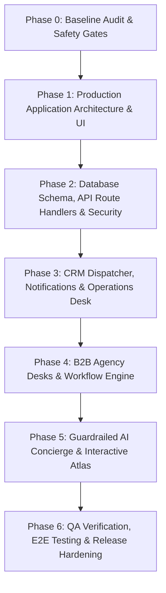

# SAFARIA Tours & Travels — Master Implementation Plan
**Document ID:** PLN-20261108-01  
**Architecture:** Next.js App Router | TypeScript | Tailwind CSS | Supabase | GoHighLevel Adapter  
**Version:** 2.0.0-PROD  
**Date of Record:** 2026-11-08

---

## 1. Phased Dependency Roadmap

---

## 2. Phase Breakdown & Acceptance Criteria

### Phase 0: Baseline Audit, Asset Preservation & Safety Gates (P0)
- **Objectives:**
  - Audit existing React prototype (`safaria_platform_master_application.md`) line-by-line.
  - Establish safe git branch `feat/safaria-production-foundation`.
  - Document baseline vulnerabilities, specification discrepancies, and risk register.
  - Enforce immutable agent constraints in `AGENTS.md`.
- **Deliverables:**
  - `docs/audits/BASELINE_AUDIT.md`
  - `docs/audits/SPEC_CONFLICTS_AND_DECISIONS.md`
  - `docs/REQUIREMENTS_TRACEABILITY.md`
  - `docs/RISK_REGISTER.md`
  - `docs/FEATURE_READINESS_MATRIX.md`
  - `AGENTS.md` in repository root.
- **Acceptance Gate:** Audit evidence confirmed against actual source code; no destructive git changes executed.

### Phase 1: Production Application Architecture & Brand Preservation (P0)
- **Objectives:**
  - Establish standard Next.js App Router project structure with strict TypeScript.
  - Compile Tailwind CSS with official design tokens (`#041713` emerald dark, `#10243A` navy, `#D6B779` gold, `#F8F5EC` ivory).
  - Preserve exact signature Bengali typography ("সঠিক ফ্লাইটে শুরু হোক যাত্রা।") and brand identity.
  - Reconstruct all 8 core services and 33 domestic & international directory destinations.
  - Fix broken `#sf-atlas` anchor navigation and responsive layout across mobile (320px–390px) and desktop (1440px).
- **Deliverables:**
  - `components/hero/HeroSection.tsx`
  - `components/atlas/JourneyAtlas.tsx`
  - `components/services/ServiceCatalog.tsx`
  - `components/destinations/DestinationGrid.tsx`
  - `components/b2b/B2BAgencySection.tsx`
  - `components/layout/SiteHeader.tsx` & `SiteFooter.tsx`
- **Acceptance Gate:** Zero console errors; responsive layout verified across 3 viewport breakpoints.

### Phase 2: Database Schema, API Route Handlers & Security Hardening (P0)
- **Objectives:**
  - Author robust PostgreSQL schema (`flight_enquiries`, `agency_applications`, `general_enquiries`, `integration_logs`).
  - Implement server Route Handlers (`app/api/enquiries/route.ts` and `app/api/agency/route.ts`).
  - Implement collision-resistant reference generation (`SFR-YYYYMMDD-XXXX`).
  - Replace `localStorage` with server-side database writes; return user success only upon verified DB commit.
  - Support full dynamic Multi-City route formulation (1–6 independent flight legs).
  - Eliminate public admin modal; enforce session/role authorization.
- **Deliverables:**
  - `supabase/migrations/001_safaria_core_schema.sql`
  - `lib/validations/enquirySchemas.ts` (Zod validation schemas)
  - `app/api/enquiries/route.ts`
  - `app/api/agency/route.ts`
  - `lib/utils/referenceGenerator.ts`
- **Acceptance Gate:** Database-backed form submissions succeed; invalid submissions rejected with exact field errors; unauthorized admin access returns HTTP 401/403.

### Phase 3: CRM Integration, Outbox Worker & Operations Desk (P0)
- **Objectives:**
  - Implement GoHighLevel v2 API adapter with idempotent contact upserts and custom field mapping.
  - Build asynchronous integration outbox with exponential backoff retry to prevent lead loss during CRM downtime.
  - Build protected operations desk for internal staff enquiry management with status state machines (`NEW` $\rightarrow$ `IN_REVIEW` $\rightarrow$ `QUOTATION_SENT` $\rightarrow$ `CLOSED`).
  - Support structured WhatsApp concierge deep-links with reference numbers.
- **Deliverables:**
  - `lib/crm/ghlAdapter.ts`
  - `app/(ops)/admin/page.tsx`
  - `lib/utils/whatsAppFormatter.ts`
- **Acceptance Gate:** Lead persists in database even if GHL is offline; manual status updates persist across sessions.

### Phase 4: B2B Agency Desks & Operations Engine (P1)
- **Objectives:**
  - Implement B2B agency application intake with trade license verification flags.
  - Implement 6-desk operational framework (FareDesk, BookingDesk, ClearMargin, AfterCare, Verified Workflow, PartnerGrowth) as protected internal workflows.
  - Lock live ticketing and real-time trial provisioning behind explicit server feature flags.
- **Deliverables:**
  - `components/b2b/B2BApplicationModal.tsx`
  - `lib/config/featureFlags.ts`
  - `lib/config/commercialConfig.ts`
- **Acceptance Gate:** Applications register as `PENDING_VERIFICATION`; no unapproved automatic trial activation or ticketing capability.

### Phase 5: Guardrailed AI Concierge & Interactive Atlas (P1)
- **Objectives:**
  - Re-engineer Voyager AI with server-side LLM provider abstraction, strict boundary guardrails, and graceful fallback.
  - Enhance Three.js Journey Atlas with raycasting, route curve animations, and camera transitions.
  - Maintain SVG mathematical curve fallback for low-power and no-WebGL devices.
  - Maintain transparent Live Aircraft Radar status banner indicating pending telemetry provider.
- **Deliverables:**
  - `components/ai/VoyagerChat.tsx`
  - `app/api/ai-assistant/route.ts`
  - `components/atlas/ThreeGlobe.tsx`
  - `components/tracking/FlightRadarCard.tsx`
- **Acceptance Gate:** AI refuses out-of-scope visa or fare guarantees; Three.js gracefully falls back to SVG on WebGL error.

### Phase 6: QA Verification, E2E Testing & Release Hardening (P0)
- **Objectives:**
  - Full TypeScript type-checking and zero ESLint errors.
  - Comprehensive unit and integration test suite covering schemas, reference generation, and Route Handlers.
  - End-to-end browser testing with Playwright (desktop, tablet, mobile viewports).
  - Localization parity check between Bengali (`/`) and English (`/en`).
  - Complete operational runbook, architecture documentation, and release checklist.
- **Deliverables:**
  - `tests/unit/enquiryValidation.test.ts`
  - `tests/unit/referenceGenerator.test.ts`
  - `tests/integration/apiRoutes.test.ts`
  - `docs/OPERATIONS_RUNBOOK.md`
  - `docs/QA_TEST_REPORT.md`
  - `docs/RELEASE_CHECKLIST.md`
- **Acceptance Gate:** 100% test pass rate; visual screenshots verified; final Go/No-Go readiness review signed off.
